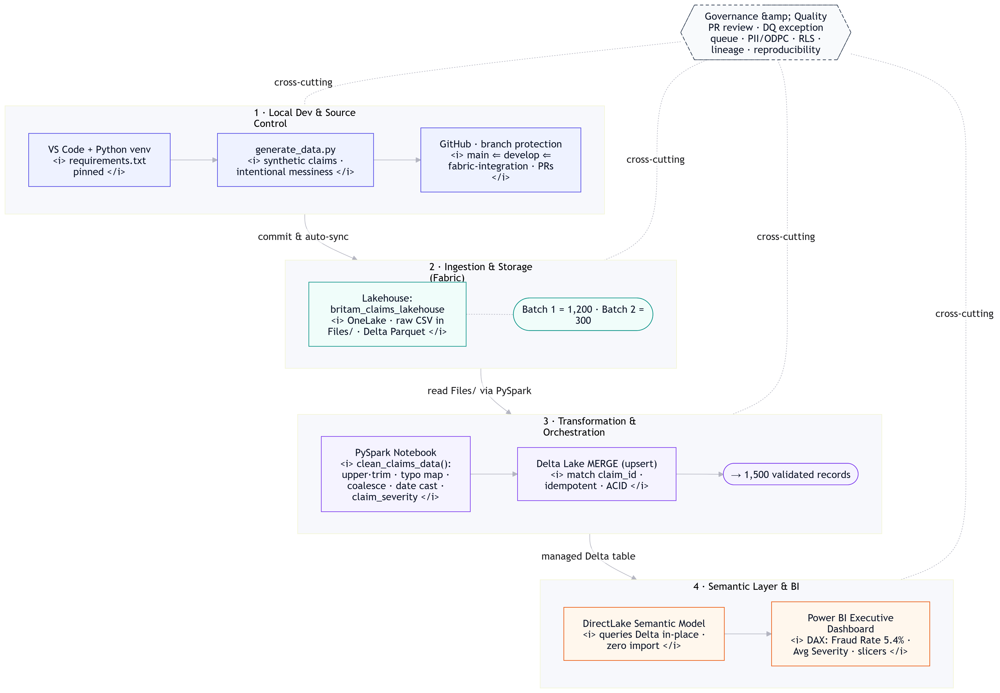
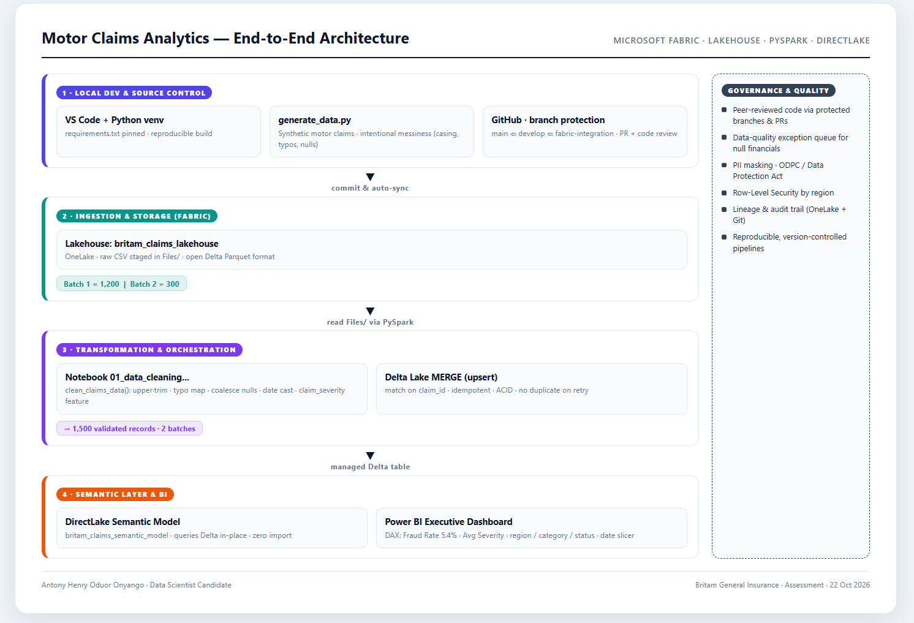

## 📊 Britam claims analytics fabric architecture

### Mermaid Architecture Diagram

### HTML Architecture Diagram

### Open this file in a browser
[Open this file in a browser](docs/architecture.html)

### Britam Claims Executive Dashboard

## 🚀 Quick Start (Local Reproduction)
1. Clone this repository.
2. Create a virtual environment: `python -m venv venv && source venv/bin/activate`
3. Install dependencies: `pip install -r requirements.txt`
4. Generate fresh data: `python scripts/generate_data.py`
5. Run validation tests: `pytest tests/`